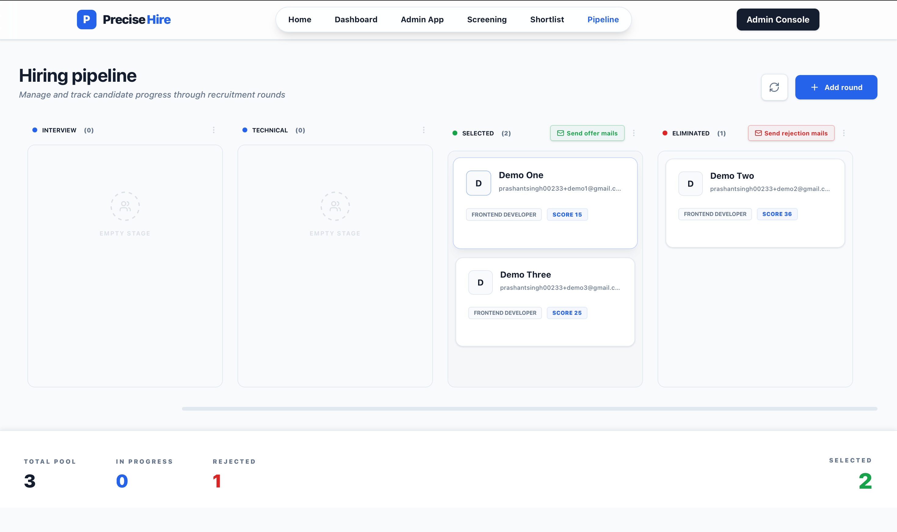
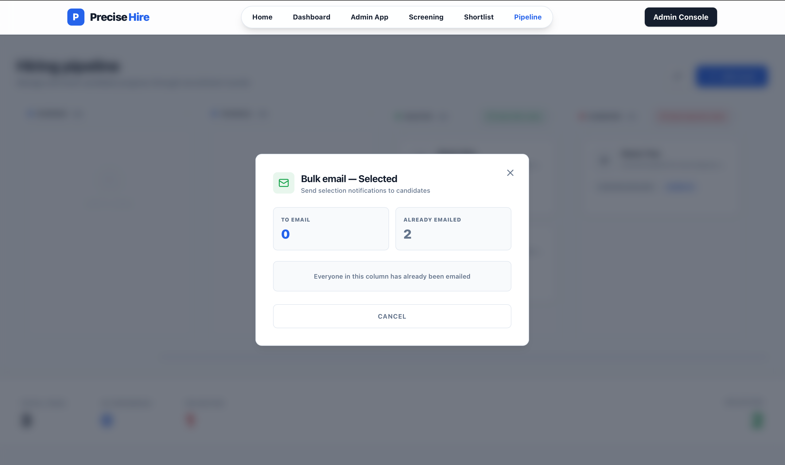

# PreciseHire 🚀

AI-assisted recruitment platform. HR uploads a candidate sheet, the backend fetches each resume, scores it against the job description with an LLM, and candidates move through a hiring pipeline with bulk selection and rejection emails.



## ✨ Features

- **Excel import with validation**: file-signature check, 1000-row cap, email de-duplication, and a per-row reason for every skipped row.
- **Resume fetching**: direct links, Google Drive and Dropbox; PDF text extraction with an AWS Textract fallback for scanned files.
- **LLM scoring**: skills, experience and resume-quality scores with configurable weights, plus matched/missing skills per candidate.
- **Kanban pipeline**: ATS, Interview, Technical, custom rounds, Selected and Eliminated.
- **Bulk emails**: one button each for Selected and Eliminated; every message is personalised with the candidate's name, with per-candidate sent tracking and a dry-run mode.



## 🧱 Architecture

React (Vite, Tailwind) → Express API → DynamoDB (jobs, candidates) and S3 (uploads); LLM through an OpenAI-compatible API (Groq `openai/gpt-oss-120b`); Nodemailer (Gmail SMTP) for email.

## 🔧 Engineering decisions

- **Parser bug:** every candidate scored 100/100/100. A weak model echoed my output template ("0-100") and the parser kept the last number. Ranges and placeholders now never become numbers, model output is validated, and invalid replies are retried with a fallback model.
- **Security audit:** closed a local-file-read and SSRF hole in the resume fetcher (scheme allow-list, private-IP and DNS-rebinding checks, redirect re-validation, size cap). Added prompt-injection defenses, rate limiting, secure headers and PII-free logs.
- **Provider-agnostic LLM layer:** the hosted model I started with was retired by the provider (HTTP 410). Base URL, key, models and timeout are now environment variables, and permanent errors (404/410) skip straight to the fallback model.
- **Safe bulk email:** the browser never sends recipient addresses. The server loads them by job and stage, saves a sent marker right after each send, and refuses to email the same person twice. `EMAIL_DRY_RUN=true` sends nothing.

## 🛠️ Tech stack

**Frontend:** React (Vite), Tailwind CSS, Framer Motion, Lucide icons
**Backend:** Node.js, Express, Nodemailer, AWS SDK (S3, DynamoDB, Textract), Jest
**Cloud:** AWS DynamoDB and S3, an OpenAI-compatible LLM API (Groq)

## 🚀 Run locally

Prerequisites: Node.js 20+, an AWS account (S3 bucket and two DynamoDB tables), an LLM API key, and a Gmail App Password if you want real emails.

1. Backend
   ```bash
   cd backend
   npm ci
   cp .env.example .env   # fill in the values; keep EMAIL_DRY_RUN=true while testing
   npm run dev            # http://localhost:5001
   ```
2. Frontend
   ```bash
   cd frontend
   echo 'VITE_API_URL=http://localhost:5001' > .env.local
   npm install
   npm run dev            # http://localhost:5173
   ```

## 🧪 Tests and CI

```bash
cd backend && npm test
```

290+ Jest unit tests cover the parsers, upload and URL validation, score validation, email templates and the bulk-email logic. A GitHub Actions workflow (`.github/workflows/ci.yml`) runs them with Node 20 on every push or pull request to `main`.

## ⚠️ Known limitations

- No user authentication yet, so keep `EMAIL_DRY_RUN=true` on any public deployment.
- Screening runs inside a single HTTP request, and the screening lock and rate limiter are in memory (single process only).
- Scoring quality has not been evaluated against recruiter rankings, so there are no accuracy numbers here on purpose.
- Resume text is sent to a third-party LLM provider.
- The frontend has existing lint warnings that are not part of the CI.